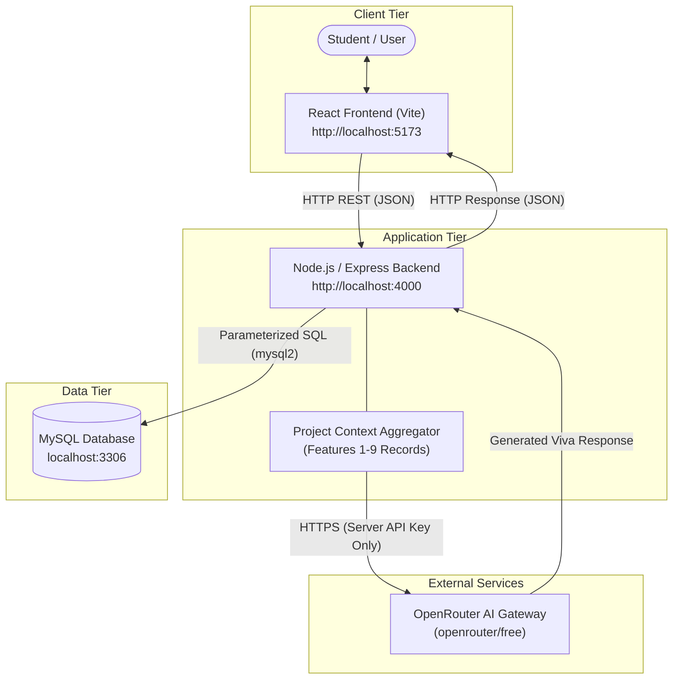

# ProjectXplain

An educational platform that transforms project ideas into structured requirements, architecture, database design, API flows, and CSE concept visualizations.

Students often build software projects without clearly understanding how requirements, database design, APIs, architecture, data flow, and Computer Science & Engineering (CSE) concepts connect together. **ProjectXplain** helps students understand these connections by turning a software project idea into a guided, structured software-engineering workflow.

---

## Key Features

ProjectXplain provides a step-by-step 10-feature progression for designing and understanding software applications:

1. **Project Creation**: Create a software project workspace with a name and high-level problem idea, saved directly to MySQL.
2. **Project Dashboard**: View real-time aggregate metrics summarizing requirements, user stories, database tables, APIs, components, flow steps, and mapped concepts.
3. **Requirements Management**: Define and organize functional requirements with explicit priority levels (`High`, `Medium`, `Low`).
4. **User Stories / Use Cases**: Decompose requirements into structured user stories nested directly under their parent requirements.
5. **Database Design**: Model relational database tables by defining entities, adding typed attributes with key constraints (`Primary Key`, `Foreign Key`, `None`), and creating inter-entity relationships (`One-to-One`, `One-to-Many`, `Many-to-Many`).
6. **API Design**: Document planned RESTful API endpoints for the student's project, specifying HTTP method, URI route, description, and sample request/response JSON payloads.  
   *(Note: This feature is used to document and design APIs for the student's project; ProjectXplain does not dynamically host or execute these documented endpoints).*
7. **System Architecture**: Model high-level system components categorized by tier (`Frontend`, `Backend`, `Database`, `Service`, `External Service`, `Other`) and establish directed communication connections between them.
8. **Request / Data Flow**: Document sequential transaction flow steps linking source components, target components, actions, protocol methods, and optional project API links to understand end-to-end data traversal.
9. **CSE Concepts**: Explore a predefined curriculum knowledge base spanning 5 core subjects (DBMS, Computer Networks, OOPS, Operating Systems, System Design) and map relevant concepts to the project with student reasoning.
10. **AI Mentor**: Query an interactive, context-aware AI Mentor that gathers the project's entire design state across Features 1–9 and provides personalized viva preparation guidance via OpenRouter.

---

## Technology Stack

| Layer | Technology | Purpose |
| :--- | :--- | :--- |
| **Frontend** | React (v18) | Single Page Application (SPA) user interface |
| **Frontend Tooling** | Vite (v5) | Development server and build bundler |
| **Styling** | Tailwind CSS (v3) | Utility-first styling and custom UI component design |
| **Backend** | Node.js | Server runtime environment |
| **Web Framework** | Express.js (v4) | RESTful API server and request routing |
| **Database** | MySQL (v8.0+) | Relational database storage |
| **Database Driver** | `mysql2` | Node.js MySQL driver with connection pooling |
| **AI Integration** | OpenAI SDK (`openai` v4) | Client SDK for dispatching server-side chat completions |
| **External AI Gateway** | OpenRouter (`openrouter/free`) | Cloud LLM gateway powering the AI Mentor feature |

---

## Project Architecture

ProjectXplain uses a clean 3-tier client-server architecture with an external AI service gateway accessed exclusively server-side:



> **Security Note**: The OpenRouter API key is kept strictly on the backend/server side. The client browser communicates only with the Express backend and never directly contacts external AI endpoints.

---

## Repository Structure

```text
ProjectXplain/
├── frontend/                  # React + Vite + Tailwind CSS client application
│   ├── src/
│   │   ├── components/        # Layout and reusable UI components
│   │   ├── pages/project/     # Workspace pages for Features 1 to 10
│   │   ├── services/          # Client API helper
│   │   ├── App.jsx            # Main workspace coordinator component
│   │   └── main.jsx           # React DOM entry point
│   ├── package.json
│   └── vite.config.js
├── backend/                   # Node.js + Express REST API application
│   ├── controllers/           # Request handlers and business logic (10 modules)
│   ├── routes/                # Express route definitions
│   ├── db/
│   │   └── connection.js      # MySQL connection pool and automatic table seeding
│   ├── app.js                 # Express application setup and middleware
│   ├── server.js              # Server listener entry point
│   ├── .env.example           # Environment template (no secrets)
│   └── package.json
├── docs/                      # Initial project planning documents
├── 01_Report/                 # Mid-Semester academic report and outline
├── 02_Requirements/           # Problem statement, scope, backlog, user stories, use cases
├── 03_Design/                 # Architecture, database, API, flow designs & Mermaid diagrams
├── 04_Source_Code/            # Source code setup and architecture documentation
├── 05_Testing/                # Test plan, functional test cases, API and database tests
├── 06_Project_Management/     # Task allocation, weekly milestones, Git log, AI disclosure
├── 07_Demo/                   # Demonstration script, presentation flow, screenshot checklist
├── .gitignore                 # Version control exclusions (.env, node_modules, dist)
└── README.md                  # Project overview and setup guide
```

---

## Prerequisites

Before setting up ProjectXplain, ensure the following are installed:

- **Node.js**: Version 18.x or higher (LTS recommended)
- **npm**: Version 9.x or higher (bundled with Node.js)
- **MySQL Server**: Version 8.0 or higher running locally on port 3306
- **Git**: For repository version control

---

## Setup and Installation

### 1. Clone the Repository

```bash
git clone https://github.com/Ramkishor315/ProjectXplain.git
cd ProjectXplain
```

### 2. Install Backend Dependencies

```bash
cd backend
npm install
```

### 3. Install Frontend Dependencies

```bash
cd ../frontend
npm install
```

### 4. Configure Backend Environment Variables

Create a `.env` file in the `backend/` directory:

```bash
cd ../backend
cp .env.example .env
```

Configure your local database credentials and OpenRouter API key in `backend/.env`:

```ini
PORT=4000
DB_HOST=localhost
DB_PORT=3306
DB_USER=your_mysql_username
DB_PASSWORD=your_mysql_password
DB_NAME=projectxplain
OPENROUTER_API_KEY=your_openrouter_api_key_here
```

### 5. Database Setup

1. Start your local MySQL server.
2. Create the target MySQL database:
   ```sql
   CREATE DATABASE IF NOT EXISTS projectxplain;
   ```
3. Ensure the root `projects` table exists in MySQL:
   ```sql
   USE projectxplain;
   CREATE TABLE IF NOT EXISTS projects (
     id INT AUTO_INCREMENT PRIMARY KEY,
     name VARCHAR(150) NOT NULL,
     idea TEXT NOT NULL,
     created_at TIMESTAMP DEFAULT CURRENT_TIMESTAMP
   );
   ```
4. Start the backend server (Step 6). The backend connection module (`backend/db/connection.js`) will automatically:
   - Check and create the remaining relational tables (`CREATE TABLE IF NOT EXISTS`).
   - Automatically seed the 5 foundational CSE subjects and 17 core educational concepts if the knowledge base is empty.

### 6. Run the Backend Server

From the `backend/` folder:

```bash
npm run dev
```

The backend server starts on `http://localhost:4000` using Node's watch mode (`node --watch server.js`).

### 7. Run the Frontend Application

In a separate terminal, from the `frontend/` folder:

```bash
npm run dev
```

The Vite development server starts and displays the local URL, typically:

```text
http://localhost:5173
```

### 8. Open the Application

Open your browser and navigate to `http://localhost:5173` to access the ProjectXplain workspace.

---

## Environment Variables & Security

- **Never commit `.env` files**: `.gitignore` is configured to exclude all `.env` files from version control.
- **Credential Isolation**: Database passwords and `OPENROUTER_API_KEY` exist only on the backend server.
- **Frontend Security**: No secrets, passwords, or bearer tokens are stored in or exposed to the frontend bundle.
- **Template Reference**: `backend/.env.example` provides the variable names without storing actual secrets.

---

## Database Overview

The ProjectXplain schema consists of relational tables organized into five domains:

- **Projects Core**: `projects` (project id, name, idea description, creation timestamp)
- **Requirements Engineering**: `requirements` (priority-tagged functional requirements), `user_stories` (nested agile stories)
- **Software Design Artifacts**:
  - `database_entities` (tables planned in student projects)
  - `entity_attributes` (table columns with data types and key constraints)
  - `entity_relationships` (One-to-One, One-to-Many, Many-to-Many relations)
  - `api_endpoints` (educational API design documentation)
  - `architecture_components` (structural system components by tier)
  - `architecture_connections` (directed inter-component communication links)
  - `data_flow_steps` (ordered sequential request/data flow steps)
- **Curriculum Knowledge Base**: `cse_subjects` (DBMS, Computer Networks, OOPS, OS, System Design), `cse_concepts` (core concepts with explanations, relevance, usage, and viva points)
- **Educational Mapping**: `project_concepts` (associative junction table linking projects to concepts with student rationale)

---

## API Overview

The following table lists the primary backend REST endpoints implemented by ProjectXplain:

| Method | Endpoint | Purpose |
| :--- | :--- | :--- |
| `GET` | `/api/health` | Service health check |
| `GET` | `/api/projects` | Fetch all projects |
| `POST` | `/api/projects` | Create a new project |
| `GET` | `/api/projects/:id` | Fetch single project details |
| `GET` | `/api/projects/:projectId/requirements` | Fetch requirements for a project |
| `POST` | `/api/projects/:projectId/requirements` | Create a requirement with priority |
| `DELETE` | `/api/requirements/:id` | Delete a requirement (cascades to user stories) |
| `GET` | `/api/requirements/:requirementId/user-stories` | Fetch user stories for a requirement |
| `POST` | `/api/requirements/:requirementId/user-stories` | Create a user story |
| `DELETE` | `/api/user-stories/:id` | Delete a user story |
| `GET` | `/api/projects/:projectId/entities` | Fetch database entities for a project |
| `POST` | `/api/projects/:projectId/entities` | Create a database entity |
| `DELETE` | `/api/entities/:id` | Delete an entity |
| `POST` | `/api/entities/:entityId/attributes` | Add attribute to an entity |
| `DELETE` | `/api/attributes/:id` | Delete an attribute |
| `GET` | `/api/projects/:projectId/relationships` | Fetch entity relationships |
| `POST` | `/api/projects/:projectId/relationships` | Create an entity relationship |
| `DELETE` | `/api/relationships/:id` | Delete an entity relationship |
| `GET` | `/api/projects/:projectId/apis` | Fetch documented API designs for a project |
| `POST` | `/api/projects/:projectId/apis` | Save a documented API endpoint design |
| `DELETE` | `/api/apis/:id` | Delete a documented API endpoint |
| `GET` | `/api/projects/:projectId/architecture/components` | Fetch architecture components |
| `POST` | `/api/projects/:projectId/architecture/components` | Create an architecture component |
| `DELETE` | `/api/architecture/components/:id` | Delete an architecture component |
| `GET` | `/api/projects/:projectId/architecture/connections` | Fetch architecture connections |
| `POST` | `/api/projects/:projectId/architecture/connections` | Create a connection between components |
| `DELETE` | `/api/architecture/connections/:id` | Delete an architecture connection |
| `GET` | `/api/projects/:projectId/data-flow` | Fetch sequential data flow steps |
| `POST` | `/api/projects/:projectId/data-flow` | Create a data flow step |
| `DELETE` | `/api/data-flow/:id` | Delete a data flow step |
| `GET` | `/api/cse-concepts/subjects` | Fetch all predefined CSE subjects |
| `GET` | `/api/cse-concepts` | Fetch all predefined CSE concepts |
| `GET` | `/api/projects/:projectId/cse-concepts` | Fetch concepts mapped to a project |
| `POST` | `/api/projects/:projectId/cse-concepts` | Map a CSE concept to a project |
| `DELETE` | `/api/project-concepts/:id` | Remove a concept mapping |
| `POST` | `/api/projects/:projectId/mentor` | Query the context-aware AI Mentor |

> **Important Distinction**: Feature 6 stores API designs/documentation for the user's project (e.g. `POST /api/matches`); those documented endpoints are project metadata and are not automatically implemented or executed by ProjectXplain.

---

## AI Mentor Architecture

The AI Mentor (Feature 10) operates through a secure, context-aware pipeline:

1. The student submits a project-specific question in the AI Mentor view.
2. The React frontend sends the question via `POST /api/projects/:projectId/mentor`.
3. The Express backend queries MySQL in parallel to gather relevant project records (requirements, user stories, database tables, attributes, relationships, documented APIs, architecture components, data flow steps, and mapped CSE concepts).
4. The backend constructs a structured project context prompt along with an academic system prompt instructing the model to assist the student with technical viva defense.
5. The backend dispatches the query to OpenRouter (`https://openrouter.ai/api/v1`) using the model `openrouter/free`.
6. The AI response is returned to the backend and sent back to the frontend to be displayed as formatted markdown.

The current implementation intentionally keeps this integration simple and robust. It does **not** include:
- Multi-turn persistent chat history
- Response streaming
- Voice input/output
- File or image uploads
- Vector databases or embeddings
- Retrieval-Augmented Generation (RAG) frameworks
- Autonomous agent loops

---

## Current Status

- **Features 1 through 10**: Fully implemented and functional in the workspace.
- **Evaluation Phase**: Current focus is on testing, documentation review, screenshot evidence collection, and mid-semester evaluation preparation.
- **Release State**: This is an academic development project for educational evaluation; it is not a production-hosted deployment.

---

## Testing

Software testing documentation and test suites are organized in the `05_Testing/` folder:

- **Functional Test Cases**: Documented in [`05_Testing/Functional_Test_Cases.md`](file:///c:/Users/kisho/OneDrive/Desktop/ProjectXplain/05_Testing/Functional_Test_Cases.md), covering 18 user workflows across all 10 features.
- **API Test Cases**: Documented in [`05_Testing/API_Test_Cases.md`](file:///c:/Users/kisho/OneDrive/Desktop/ProjectXplain/05_Testing/API_Test_Cases.md), covering positive and negative HTTP responses across backend routes.
- **Database Test Cases**: Documented in [`05_Testing/Database_Test_Cases.md`](file:///c:/Users/kisho/OneDrive/Desktop/ProjectXplain/05_Testing/Database_Test_Cases.md), verifying schema creation, foreign key cascade rules, and uniqueness constraints.

*Note: Test cases have been formally structured for the evaluation milestone; tests that have not yet undergone formal post-development regression execution are explicitly marked as "Not yet executed".*

---

## Documentation Suite

The repository includes a complete documentation structure for academic evaluation:

- [`01_Report/`](file:///c:/Users/kisho/OneDrive/Desktop/ProjectXplain/01_Report/): Mid-Semester Evaluation Report draft and detailed report outline.
- [`02_Requirements/`](file:///c:/Users/kisho/OneDrive/Desktop/ProjectXplain/02_Requirements/): Problem statement, objectives, scope, stakeholders, functional & non-functional requirements, product backlog, user stories, and use cases.
- [`03_Design/`](file:///c:/Users/kisho/OneDrive/Desktop/ProjectXplain/03_Design/): System architecture, database design, API design, data flow design, and Mermaid diagrams.
- [`04_Source_Code/`](file:///c:/Users/kisho/OneDrive/Desktop/ProjectXplain/04_Source_Code/): Source code documentation and architecture setup guide.
- [`05_Testing/`](file:///c:/Users/kisho/OneDrive/Desktop/ProjectXplain/05_Testing/): Test plan, functional test cases, API test cases, database test cases, and test summary.
- [`06_Project_Management/`](file:///c:/Users/kisho/OneDrive/Desktop/ProjectXplain/06_Project_Management/): Task allocation, weekly milestones, meeting templates, individual contributions, Git log, and AI usage disclosure.
- [`07_Demo/`](file:///c:/Users/kisho/OneDrive/Desktop/ProjectXplain/07_Demo/): Timed 5–7 minute demo script, step-by-step navigation flow, and screenshot evidence checklist.

---

## Team

- **Saksham**
- **Ravi**
- **Ram Kishor**
- **Priyanshu**

Department of Computer Science and Engineering  
Motilal Nehru National Institute of Technology (MNNIT) Allahabad

---

## AI Usage

In compliance with academic standards:
- AI-assisted development tools (such as Antigravity) were utilized during the project for code boilerplate assistance, debugging, documentation structuring, UI layout styling, and technical explanations.
- All generated code and documentation was reviewed, tested, modified, and verified by the student development team.
- The team maintains complete ownership and understanding of the codebase and is prepared to explain and defend every component during oral examination.

---

## Planned Future Work

The following enhancements are documented in the product backlog as planned future extensions for subsequent milestones:

- **Project Export Engine**: One-click generation of compiled software design documents in PDF or Markdown format.
- **Interactive Visualizations**: Interactive graph rendering for architecture components and database entity-relationship diagrams.
- **Design Validation Checks**: Automated warnings for incomplete models (e.g., entities without primary keys, components without connections).
- **User Authentication & Collaboration**: User accounts and multi-student project sharing.
